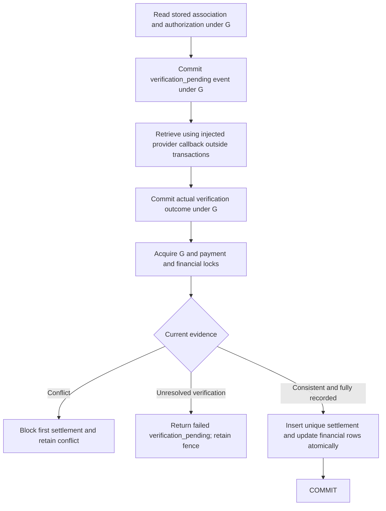

# Settlement quarantine and verification durability (Phase 7E.9J)

This remains a synthetic, local PostgreSQL prototype. Payments stay disabled.
Provider responses come from injected callbacks; this is not live account verification.

## Defects and correction

P1-3: the inbox was checked before retrieval, but settlement insertion never
checked it again. A valid response already in flight could override a quarantine
committed by another request. The final transaction now revalidates the stored
association, immutable authorization, and all current payment evidence while
holding the component transaction gate G and payment/financial row locks. An
inspection failure rolls back; a conflict prevents the first settlement.

P1-4: `recordVerification` discarded the transaction result, so a failed history
insert could be reported as quarantine even though no evidence existed. Returning
an error alone would still leave the next valid retrieval free to settle.

The minimum schema change is **one additional processing status** on the existing
settlement-owned event table: `verification_pending`. Before retrieval, the server
commits an event with a unique internal ID and this status. After retrieval, it
updates that same event to the actual outcome. Both persistence results are checked.
No new table, commercial migration, or production payment path is introduced.
Disposable fixtures must be rebuilt with the updated schema.

## Persistence and recovery contract

* Registration failure: return `failed` / `square_settlement_verification_history_unconfirmed`;
  do not call the provider callback. Confirmed rollback leaves no attempt to resolve.
* Outcome-write failure: return the same explicit failure, never completed quarantine.
  The previously committed pending event blocks all first-settlement attempts,
  including earlier in-flight valid responses and later valid retries.
* A normal retry may retrieve again and durably record a genuine conflict. Later
  ordinary reconciliation then reports quarantine without another retrieval.
* A valid retry cannot resolve an earlier unknown outcome. An abandoned pending
  event needs investigation. This change deliberately provides **no automatic
  timeout, deletion, reset, or administrative release** of that financial fence.
  Such a release requires a separately reviewed evidence/recovery procedure.
* Transient retrieval failures that were successfully recorded remain audit history
  and permit legitimate retries (P1-2). Explicit quarantine is never interpreted as
  an unavailable retrieval, even if the provider omitted usable payment fields.
* Concurrent valid calls record their outcomes before attempting settlement. A call
  may wait up to two seconds outside transactions for another outcome to resolve.
  Expiry returns `failed` / `square_settlement_verification_pending`; it never clears
  a pending event. Settlement uniqueness and idempotent confirmation remain intact.
* Registration also rechecks settlement under G. If settlement committed between
  the initial operation read and registration, confirm the matching row without
  starting a late retrieval. Otherwise the new fence precedes any first settlement.
  A controlled COMMIT barrier regression covers this additional reverse ordering.
* Successful retrieval evidence survives a later financial rollback. Financial rows
  still roll back atomically, and a fresh verified retry can settle exactly once.

`databaseCommitState` on persistence errors distinguishes `rolled_back` (an error
before COMMIT with acknowledged rollback) from `unknown` (including a failed COMMIT
acknowledgement). A ROLLBACK after COMMIT failure does not prove COMMIT was undone.
Retries inspect durable evidence. A cleanup error is reported as
`databaseCleanupFailed: true`; an acknowledged COMMIT remains `committed` and its
financial result is preserved. History cleanup failure is propagated as a failed,
unconfirmed-history response, and later requests inspect the committed history.

If a settlement already committed before a later conflicting event, retain the
matching financial row and report `already_settled`, `financiallySettled: true`,
`settlementCommitted: false`, `investigationRequired: true`, and
`square_settlement_observations_conflict`. The late event remains `inconsistent`.
Do not erase or rewrite the settlement or pretend that it never committed.

## Validation

The unchanged 87806a7 settlement baseline passed its existing 60 tests. Four new
regressions failed against it: amount and payment-ID quarantine races, later
conflict reporting, and a PostgreSQL trigger forcing verification-history failure.
The signed baseline at 42ed479 independently reproduced both P1 defects.

Regressions use real disposable PostgreSQL, controlled provider barriers, a real
history-write trigger, and wrappers around actual PostgreSQL clients for COMMIT
acknowledgement and cleanup faults. Existing concurrency, global gate, uniqueness,
isolation, P1-1 rejection and P1-2 recovery assertions remain required.

Two older assertions intentionally change: manual successful retrieval can no
longer override recorded conflicts; and retrieval evidence remains stored after a
financial rollback. Neither change relaxes a financial safety assertion.
